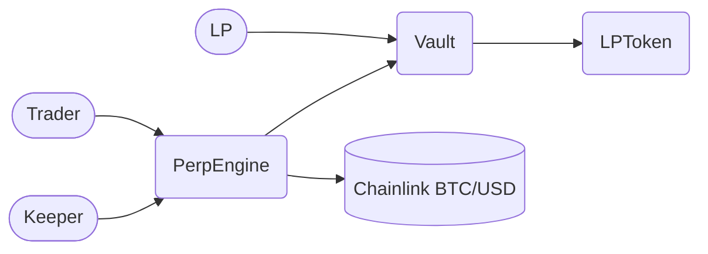
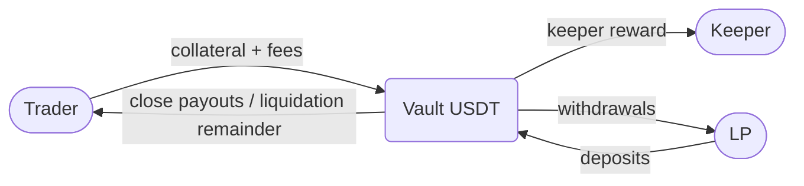

# Architecture — Perp-Trade Protocol

Counterparty-liquidity perpetuals engine. LPs fund a USDT Vault; traders open
collateralized BTC long/short positions priced by a Chainlink oracle; a keeper
bot liquidates underwater positions.

### How trading really works — the pool takes the other side

There is no marketplace here. You never buy from or sell to another trader.
When you open a long, no one opens a short for you. The pool of USDT that
liquidity providers deposited simply promises to pay you if you win, and keeps
your money if you lose.

Price comes from one place only: the Chainlink oracle. When you open, the
contract saves the current BTC price as your entry price. When you close, it
checks the price again and pays you based on how far it moved. Your trade size
changes nothing about the price — a 100 USDT trade and a 70,000 USDT trade in
the same block get the exact same entry price. There is no price impact and no
slippage.

That means all profit comes out of the liquidity providers' deposits, and all
losses go into them, plus a small 0.1% fee each way. If every trader is winning
at once, the pool is the one losing. Two safety rules keep the pool alive:
only 80% of pool money can back open trades at once, and losing positions are
closed by force once they have lost 20% of their posted collateral.

## Contracts

| Contract | File | Owns | Key functions |
|---|---|---|---|
| `PerpEngine` | `src/PerpEngine.sol` | Positions, margin checks, PnL, liquidation | `openPosition`, `increasePositionSize`, `addCollateral`, `closePosition`, `liquidate`, views |
| `Vault` | `src/Vault.sol` | USDT custody + `totalLiquidity` / `reservedLiquidity` | `deposit`, `withdraw`, `reserve/releaseLiquidity`, `settlePnL` |
| `LPToken` | `src/LPToken.sol` | `vUSD` receipt token, 1:1 mint/burn | `mint`, `burn` |
| `PriceConverter` | `src/lib/PriceConverter.sol` | `answer (8 dec) * 1e10 -> price (18 dec)` | `getPrice` |

`PerpEngine` holds no USDT. All collateral, fees, and payouts sit in `Vault`.
`Vault` never prices anything; it only obeys `PerpEngine` instructions.

## Deployment and trust wiring

Order from `script/Deployer.s.sol`:

1. Deploy `MockUSDT`, `LPToken`, `Vault(usdt, lpToken)`, mock feed, `PerpEngine(vault, usdt, feed)`.
2. `lpToken.grantMintAndBurnRole(vault)` — only the Vault can mint/burn vUSD.
3. `vault.grantPerpEngineRole(perpEngine)` — only the engine can reserve, release, or settle.

| Call | Who can call |
|---|---|
| `Vault.deposit / withdraw` | Anyone (LP) |
| `Vault.reserve / release / settlePnL` | `PerpEngine` only (`PERP_ENGINE_ROLE`) |
| `LPToken.mint / burn` | `Vault` only (`MINT_AND_BURN_ROLE`) |
| `PerpEngine.close / increase / addCollateral` | Position owner only |
| `PerpEngine.liquidate` | Anyone (keeper bot) |

## Call graph (who calls whom)

`PerpEngine` reads the feed through the `PriceConverter` library and issues
`reserve / release / settlePnL` instructions to `Vault`. `Vault` mints/burns
`LPToken` on deposit/withdraw.

## Fund flows (where USDT moves)

All trader USDT enters and leaves through the Vault; `PerpEngine` only routes
it via `transferFrom` / `settlePnL`. See `docs/FLOWS.md` for sequences and
`docs/ENGINE.md` for the engine internals.
