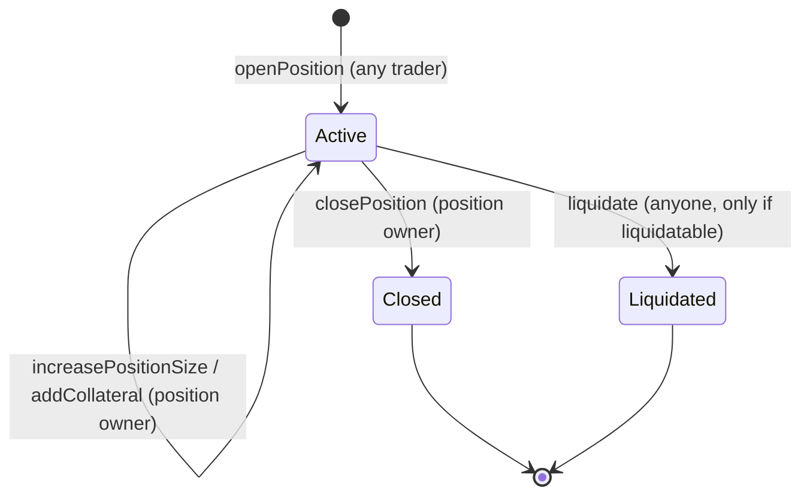
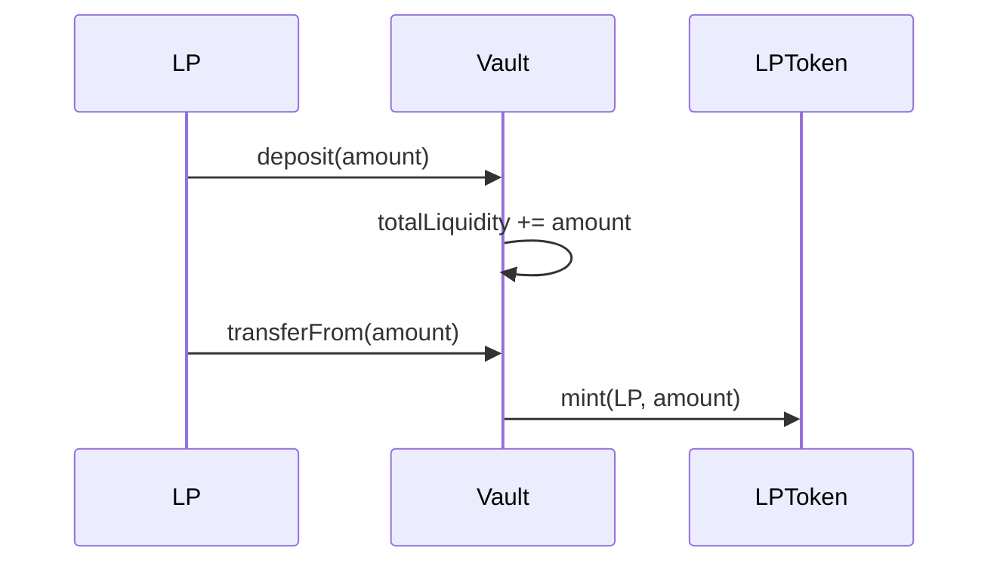
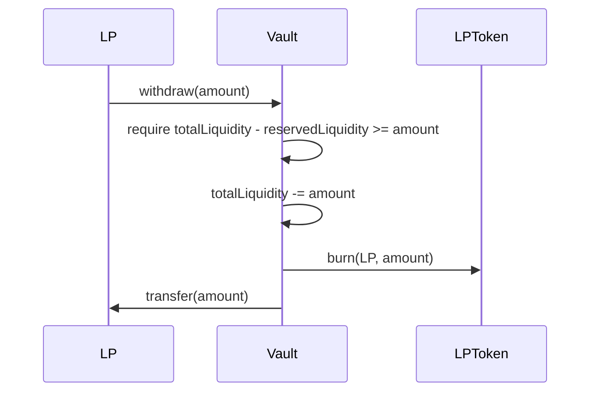
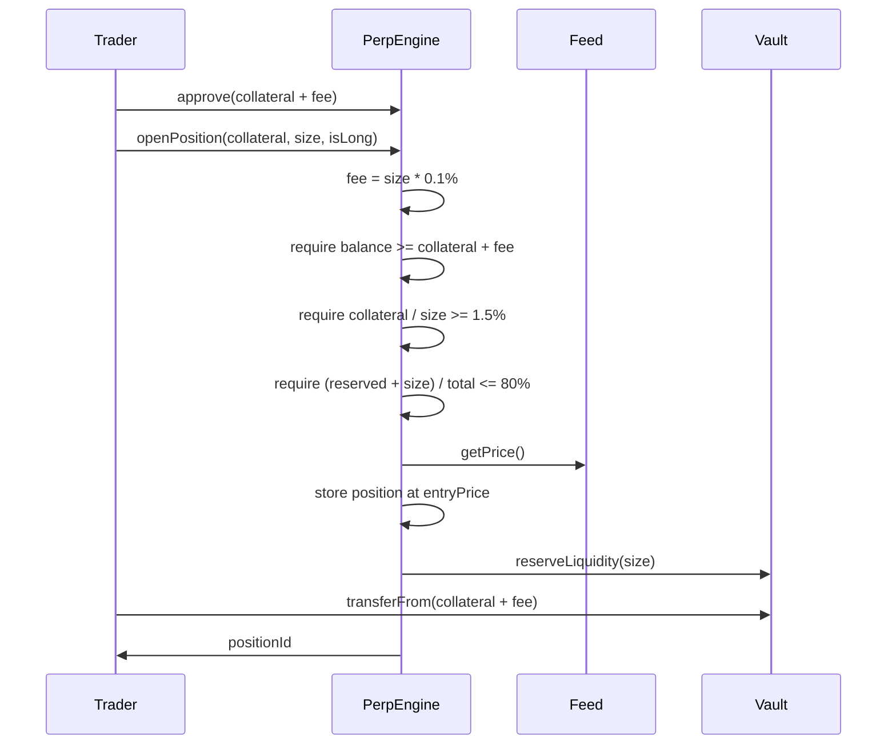
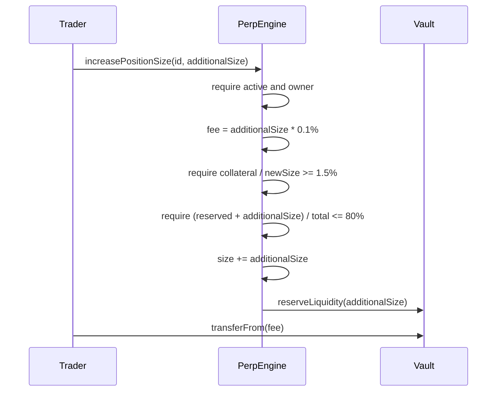
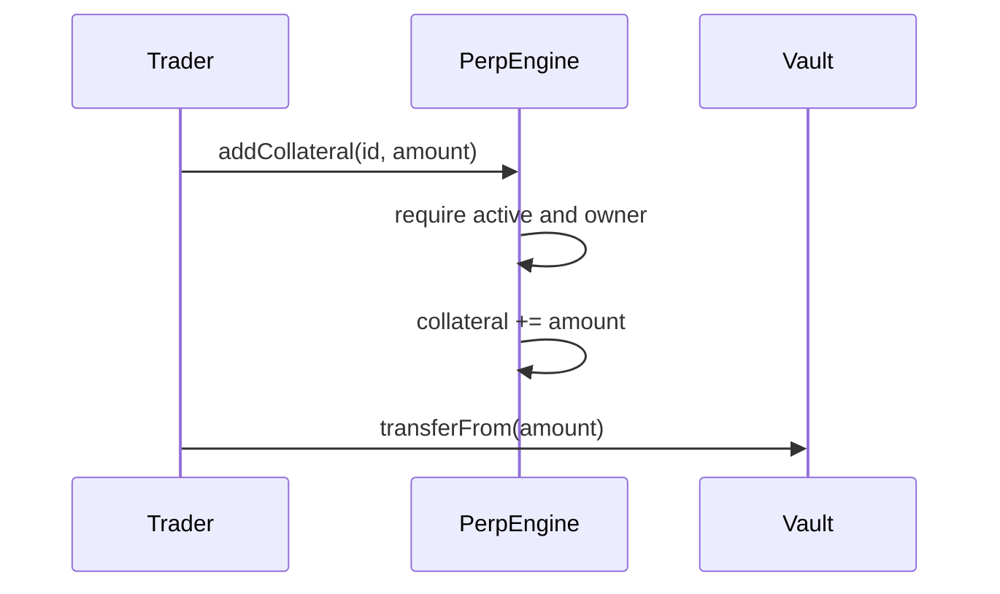

# Lifecycle Flows — Perp-Trade Protocol

Exact call order matches the code. `T` approves `PerpEngine` before any USDT
pull; the engine then routes everything into/out of `Vault`.

## Position state machine



No partial close, no position transfer. IDs start at 1, are never reused, and
`traderPositions` keeps closed IDs forever.

## LP deposit



## LP withdraw



Reserved liquidity can never be withdrawn — open positions always keep
pool money locked to cover payouts.

## Open position

Code order: fee, balance check, collateral-ratio check, utilization check,
price read, state write, reserve, stats, token pull, event.



## Increase size (no new collateral)

Only the 0.1% fee on the added size is pulled. The existing collateral must
cover the new, larger size at the 1.5% ratio — so this always raises leverage.



## Add collateral (no price read, no fee)

Lowers leverage / pushes liquidation further away. Entry price and size are
untouched.



## Close position

```mermaid
sequenceDiagram
    participant T as Trader
    participant PE as PerpEngine
    participant F as Feed
    participant V as Vault
    T->>PE: closePosition(id)
    PE->>PE: require active and owner
    PE->>F: getPrice()
    PE->>PE: pnl = calcPnL(); payout = collateral + pnl - fee
    PE->>V: releaseLiquidity(size)
    PE->>V: settlePnL(trader, payout)
    alt payout > 0
        V->>T: transfer(payout); totalLiquidity -= payout
    else payout <= 0
        V->>V: totalLiquidity += loss (no transfer; trader gets nothing)
    end
```

## Liquidate (no close fee)

```mermaid
sequenceDiagram
    participant K as Keeper
    participant PE as PerpEngine
    participant F as Feed
    participant V as Vault
    K->>PE: liquidate(id)
    PE->>PE: require active
    PE->>F: getPrice()
    PE->>PE: remaining = collateral + pnl
    PE->>PE: require remaining <= 80% of collateral
    PE->>V: releaseLiquidity(size)
    alt remaining > reward (5% of collateral)
        V->>K: transfer(reward)
        V->>T: transfer(remaining - reward)
    else 0 < remaining <= reward
        V->>K: transfer(remaining)
    else remaining <= 0
        V->>V: no transfer; collateral stays in Vault
    end
```
